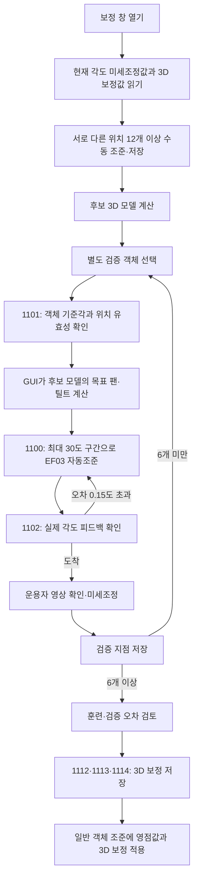

# 카메라 3D 보정과 검증 자동조준 흐름

이 문서는 GUI에서 보정 지점을 수집한 뒤 ECS가 FCS를 검증 위치로 자동조준하고, 확정된 3D 보정값을 실제 객체 지향 계산에 적용하는 전체 흐름을 정의한다.

## 핵심 원칙

- 최초 보정 지점 수집은 운용자가 카메라 영상을 보며 수동으로 맞춘다.
- 별도 검증 지점에서는 아직 저장하지 않은 후보 3D 모델로 먼저 자동조준한다.
- 검증 자동조준은 `CalibrationPoint(1100)` 명령이며 ECS가 FCS `EF03`으로 변환한다.
- FCS 실제 각도는 `CalibrationFeedback(1102)`로 확인한다. 명령 성공만으로 도착했다고 판단하지 않는다.
- 보정값 적용(`1112`~`1114`)은 설정만 저장하며 FCS를 움직이지 않는다.
- 보정 지점은 RDR 기준 상대좌표로 저장하며, 보정 당시 RDR/FCS 설치 기준점도 함께 저장한다.
- 현재 실제 설치 좌표가 바뀌면 보정 당시 기준점과의 상대 간격 차이를 조준 벡터에 반영한다. 두 장비를 같은 양만큼 평행 이동한 경우에는 조준각이 유지된다.
- 장비 장착 방향이나 광축이 바뀌면 설치 좌표만으로 보상할 수 없으므로 다시 보정해야 한다.

## 전체 상태 흐름



## IPC 명령 계약

| 명령 | 역할 | 주요 조건 |
|---|---|---|
| `1100 CalibrationPoint` | 검증 자동조준 또는 수동 미세 이동 | `TargetId=0`, `PositionZ=0`, 한 구간 팬·틸트 변화 각각 30도 이하 |
| `1101 CalibrationReference` | 선택 객체의 기준 팬·틸트 계산 및 객체 유효성 확인 | 객체가 현재 RDR 관측에 존재해야 함 |
| `1102 CalibrationFeedback` | FCS가 보고한 실제 팬·틸트 반환 | 명령 이후 새 상태가 수신되어야 함 |
| `1110/1111` | 현재 3D 이동·회전값 읽기 | 동일 토큰으로 한 스냅샷을 읽음 |
| `1112/1113` | 새 이동·회전값 임시 저장 | 30초 안에 같은 토큰으로 순서대로 전송 |
| `1114` | 임시 3D 보정값 확정 | 설정 파일 저장 후 정렬 상태 무효화, 장치 이동 없음 |

## ECS 처리 규칙

1. 수동 촬영, 일괄 촬영, 연속 촬영 또는 기존 객체 할당이 진행 중이면 보정 이동을 거부한다.
2. `1100`의 팬은 0도 이상 360도 미만, 틸트는 -30도 이상 90도 이하이어야 한다.
3. 한 번의 `1100` 이동은 각 축 30.01도를 넘을 수 없다. GUI가 긴 이동을 여러 구간으로 나눈다.
4. ECS는 `1100`을 0.1도 단위로 반올림해 FCS `EF03`을 전송하고 마지막 목표각을 보관한다.
5. `1102`는 FCS 상태 응답의 실제 방위각·고각을 반환한다.
6. 후보 모델 저장은 translation → rotation → commit의 원자적 순서를 사용한다. 중간 값만으로는 적용하지 않는다.
7. 3D 보정이 활성화되면 RDR 상대좌표를 변환하고, 보정 당시와 현재의 RDR/FCS 설치 간격 차이를 반영해 조준각을 계산한 뒤 카메라 각도 미세조정값을 더한다.

## 중단 조건과 오차 기준

- 선택 객체가 사라지거나 RDR 상대좌표가 5cm 넘게 바뀌면 자동조준을 중단한다.
- 자동조준은 실제각이 목표각의 팬·틸트 각각 0.15도 이내일 때 도착으로 판단한다.
- 각 구간의 도착 확인이 20초를 넘으면 중단한다.
- 객체 선택부터 저장까지 기준각이 0.2도 넘게 달라지면 같은 객체로 인정하지 않는다.
- ECS/FCS 연결 끊김, 최신 상태 부재, 다른 시퀀스 점유는 즉시 실패로 반환한다.

## 로그 확인

정상 자동조준이면 ECS 이벤트 로그에 다음 순서가 남는다.

1. `GUI command=1101 ... result=0`
2. 하나 이상의 `FCS EF03_CALIBRATION ...`
3. 각 이동에 대응하는 `GUI command=1100 ... result=0`
4. 도착 확인 중 `GUI command=1102 ... result=0`

`1101`만 있고 `1100`이 없다면 검증 단계가 아니거나, 계산된 목표각과 현재각의 차이가 이미 0.15도 이내인지 GUI 상태를 확인한다.

## 회귀시험

```powershell
msbuild .\ai-generated-c2.sln /m /p:Configuration=Release /p:Platform=x64
& .\x64\Release\C2.Tests.exe
python .\C2.Tests\Integration\test_calibration_mode.py --console .\x64\Release\C2.Console.exe
python .\C2.Tests\Integration\test_geometry_calibration.py --console .\x64\Release\C2.Console.exe
python .\C2.Tests\Integration\test_angle_calibration.py --console .\x64\Release\C2.Console.exe
```

통합시험은 `1100 → EF03`, 실제각 피드백, 30도 구간 제한, 실제 RDR/FCS 설치 간격 변경에 따른 조준각 변경, 저장된 3D 보정과 각도 미세조정의 일반 객체 조준 반영을 검증한다.
