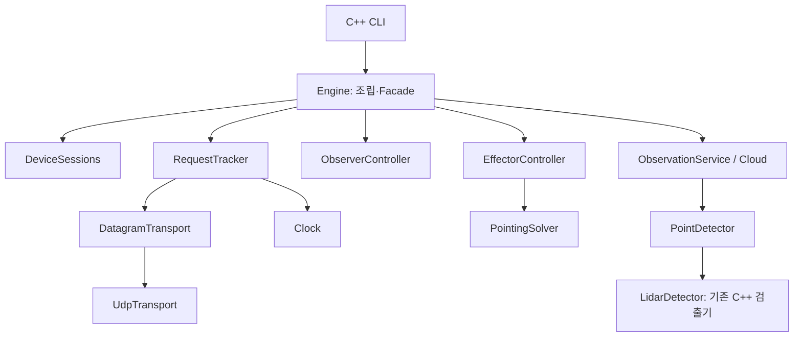

# C++ 통제소의 객체지향 설계와 검증 근거

실행 경로는 `c2_mvp_console → Engine → C2 서비스`입니다. Python 실행기와 Python 제어부는 제거했습니다.
이번 담당 범위는 통제소입니다. 장치 내부 firmware, SDK, 모터 드라이버는 수정하지 않았습니다.

## 책임과 의존성

| 책임 | 실제 코드 | 규칙 |
| --- | --- | --- |
| 조립·분배 | `native/engine.cpp` | CLI 위임, 수신 분배, snapshot, 시간 변화 감지 |
| 장치 | `native/devices.cpp` | 등록, boot/session 교체, 설치 확인, 상태·Heartbeat 순번 |
| 요청 | `native/requests.cpp` | 값 복사, 동일 바이트 재전송, 응답 연결, 완료·취소·timeout |
| EFF 명령 | `native/effector.cpp` | 단발 이동, 연속 aim, 관측·각도 한계, STOP fence와 후속 실측 확인 |
| OBS 명령 | `native/observer.cpp`, `states.cpp` | EFF 정지 → 수집 중지 → 이동 → 결과와 실측 정지 → 수집 |
| 관측 | `native/observation.cpp` | 조립, worker·최신 작업 1개, 시각·자세·설치 검증, 검출 결과 연속성 |
| 외부 경계 | `transport.cpp`, `pointing.cpp`, `domain.hpp` | 가상 인터페이스와 실제 구현 |

`Peer`, `EffectorSession`, `ObserverOperation`, `Observation`, `Installation`은 C++ 형식으로 표현합니다.
JSON은 설정·CLI 출력·외부 시각 증빙에 사용하고, 주요 상태를 JSON 딕셔너리로 관리하지 않습니다.
서비스는 Engine을 통해 협력하며 완전히 독립적인 도메인 계층은 아닙니다. 시간·통신·검출·계산 경계에서 의존성을 역전했습니다.

## 패턴을 적용한 이유

- **Strategy:** `PointingSolver::solve()`를 `EffectorController`에 주입합니다. `RelativePointingSolver`는 기존 설치값·상대 벡터·atan2 계산을 수행합니다. 계산을 교체해도 통제소의 한계 검사·명령 완료 규칙을 우회할 수 없습니다.
- **Adapter:** `UdpTransport`는 소켓을 `DatagramTransport`로, `LidarDetector`는 기존 Watch::Detector의 입출력을 `PointDetector`로 연결합니다. Python·자식 검출 프로세스는 필요 없습니다.
- **Facade:** CLI는 Engine을 통해 내부 서비스를 사용합니다.
- **의존성 주입:** Clock, DatagramTransport, PointDetector, PointingSolver를 참조로 전달합니다. 수명은 조립 지점이 소유하며 Engine보다 오래 유지합니다.
- **명시적 FSM:** `ObserverOperation::transition()`이 허용된 전이만 수락합니다. 상태별 클래스를 만든 GoF State 패턴은 아닙니다.

## 실행과 동시성

운영 CLI는 수신·tick 스레드와 stdin 스레드의 서비스 접근을 mutex로 직렬화합니다.
검출 스레드는 완성 프레임 작업만 받아 계산하며, Engine의 장치·제어 상태에 접근하지 않습니다.
세대 번호가 달라진 검출 결과는 폐기합니다. 작업 대기 슬롯은 최신 1개입니다.
전송 중인 명령은 Protobuf 값 복사로 고정하고, 재전송은 직렬화한 같은 바이트를 재사용합니다.
완료 콜백 호출 전에 pending에서 제거하므로 콜백이 STOP을 등록해도 새 요청을 지우지 않습니다.

## 하드웨어 없이 검증

`tests/native_behaviors.cpp`의 Fixture는 FakeClock, FakeTransport, FakeDetector, Solver를 생성하고
`Engine(..., false)`로 worker 없이 조립합니다. 실제 소켓이나 sleep 없이 시간을 전진시켜 제어 규칙을 검사합니다.
반면 `tests/test_native_mvp.py`는 실제 C++ 프로세스와 UDP를 사용하며 Python은 장치 더미와 시험 도구로만 실행합니다.
C2 프로세스의 PATH를 비워 Python을 검색할 수 없는 조건에서도 같은 시나리오를 수행합니다.

면접에서는 패턴 개수보다 **변경되는 계산·통신 구현과 유지돼야 할 제어 규칙을 분리해 검증 가능하게 만든 이유**를 설명합니다.
