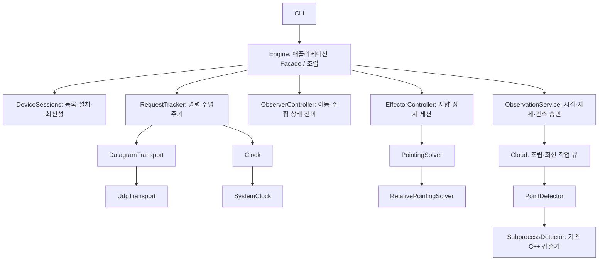

# 현재 CLI C2의 객체지향 설계와 검증 근거

이 문서는 실제 실행 경로인 `scripts/run_team_mvp.py → team_mvp.Engine`을 설명합니다.
초기 C++ ControlCenter나 legacy v3 서버의 구조를 현재 CLI 구조와 혼용하지 않습니다.

## 책임과 의존성



| 책임 | 소스 | 보유하는 규칙 |
| --- | --- | --- |
| 애플리케이션 진입점 | `team_mvp/engine.py` | 의존성 조립, 수신 분배, 직렬화된 서비스 호출, CLI snapshot, 종료 |
| 장치 세션 | `team_mvp/devices.py` | boot/session 교체, 등록·설치 협상, Heartbeat/각도 순번과 최신성 |
| 명령 수명주기 | `team_mvp/requests.py` | 정확히 같은 바이트 재전송, 요청/세션/epoch/순번 일치, ACCEPTED와 완료 구분, 취소·timeout |
| OBS 흐름 | `team_mvp/observer.py` | EFF 정지→수집 중지→OBS 이동→후속 실측 정지→수집 재개 |
| EFF 흐름 | `team_mvp/effector.py` | 제어 세션, 목표·장치 유효성, 지향 빈도, 한계 검사, STOP 확인 |
| 관측 승인 | `team_mvp/observation.py` | 외부 시각 증빙·취득 자세·설치 revision 검증, 단일 물체 연속성 |
| 입출력 어댑터 | `transport.py`, `detection.py` | UDP와 C++ 프로세스 API를 포트 계약으로 제공 |

서비스는 Engine 클래스를 import하지 않습니다. ObserverHost/EffectorHost/DeviceHost/ObservationHost라는
역할별 Protocol이 협력 서비스의 필요한 API를 명시하고 Engine이 그 계약을 제공합니다.
서비스 호출과 콜백은 애플리케이션 RLock 아래에서 직렬화합니다. 독립 서비스에 임의로 병렬 호출하지 않습니다.

## 적용한 설계와 패턴

- **책임 분리·캡슐화:** 재시도는 RequestTracker, 상태 전이는 ObserverController가 소유합니다.
  OBS/EFF 동작 데이터는 dataclass와 Enum으로 표현합니다. 장치 메타데이터 일부는 기존 dictionary를 유지했습니다.
- **의존성 주입:** Engine 생성 시 Clock, DatagramTransport, PointDetector, PointingSolver를 교체할 수 있습니다.
  SystemClock/UdpTransport는 운영 기본값이고 FakeClock/FakeTransport는 테스트 대역입니다.
- **Strategy:** EffectorController가 PointingSolver.solve에 지향 계산을 위임합니다. 기본 구현은 기존 상대 벡터 atan2 계산입니다.
  시험에서는 다른 계산 구현을 넣어 동일 제어 흐름이 사용되는지 확인하며, 허용각 검사는 제어 서비스가 계속 수행합니다.
- **Adapter:** UdpTransport는 소켓 API를, SubprocessDetector는 C++ worker의 내부 binary stdin/stdout을 포트 계약으로 감쌉니다.
- **Facade:** 기존 CLI는 Engine의 point/aim/stop/obs_point 등을 호출합니다. 내부 서비스가 나뉘어도 CLI 사용법은 유지합니다.
- **명시적 유한 상태 머신:** ObserverOperation의 허용 전이표가 수집 재개를 건너뛰는 전이와 종료 후 재진입을 막습니다.
  상태별 클래스를 둔 GoF State 패턴은 아닙니다. 목적 없이 상태마다 클래스를 추가하지 않았습니다.

인터페이스/콜백을 사용했다는 사실만으로 Observer, Command, Abstract Factory 패턴을 적용했다고 주장하지 않습니다.
또한 테스트용 데이터 구조를 제외한 전체 시스템이 완전한 순수 도메인 모델로 전환된 것은 아닙니다.

## 테스트에서 외부 의존성을 통제하는 방법

```python
engine = Engine(config, fake_detector,
                clock=fake_clock, transport=fake_transport,
                autostart=False, pointing_solver=test_solver)
fake_clock.advance(0.201)
engine.tick()
```

이 모드는 UDP 소켓·수신 스레드·검출 worker 스레드를 만들지 않습니다. 테스트가 시간을 전진시키며
실제 재시도와 OBS/EFF 서비스를 호출합니다. Thread/네트워크 스케줄링 대신 명령·상태를 직접 검증합니다.
프로덕션 기본값은 실제 시계·UDP·worker입니다. 종료 대기는 실제 I/O를 기다리는 인프라 책임이므로 실제 시간으로 제한합니다.

## 동작을 보존하는 경계

공용 .proto·wire 형식, 기존 CLI 명령, Detector의 C++ 구현, 모터 firmware는 바꾸지 않습니다.
기존 `Engine.pending` 진단 view와 `from team_mvp.cloud import Detector`도 호환 경로로 유지합니다.
새 코드가 하드웨어 검증이나 기존 OBS 0도 고정 관측 제한을 없애지는 않습니다.

## 테스트 근거

| 시험 | 외부 의존성 | 검증하는 요구 |
| --- | --- | --- |
| `tests/test_design.py` | 가짜 시계·메모리 전송기·가짜 협력 포트 | 재전송/취소/응답 일치, 벽시계와 deadline 분리, OBS 정지 전 수집 금지, 지연 응답 차단, Strategy 교체, 최신성 |
| `tests/test_team_mvp.py` | 실제 UDP·Python 더미·C++ 검출기 | 기존 17개 CLI/통신/점군/aim/stop 회귀 |
| firmware `tests/test_c2_link.py` | native C++ OBS/EFF, Linux에서는 UART PTY | 프롬프트 입력과 장치간 전체 11개 연동·응답 유실·정지 |

단위 시험이 통과해도 실제 UDP와 프로세스 연동은 별도로 검증합니다. 처리량·PetaLinux ABI·물리 장비 동작은
이 구조 개선으로 검증된 것으로 간주하지 않습니다.

## PT에서 설명할 예시

“원본 점군 취득과 장치 통신을 실제 장비에 묶으면 장애 상황을 재현하기 어려웠습니다.
시간·전송·검출·지향 계산을 교체 가능한 의존성으로 분리하고, 명령 관리와 OBS/EFF 상태 흐름을 독립 서비스로 만들었습니다.
가짜 시계로 timeout과 지연 응답을 검증하면서 실제 UDP/native 장치 통합 시험도 유지했습니다.”

본인이 변경 이유·협력 객체·실패 테스트를 직접 재현하고 설명할 수 있는 범위에서 사용합니다.
